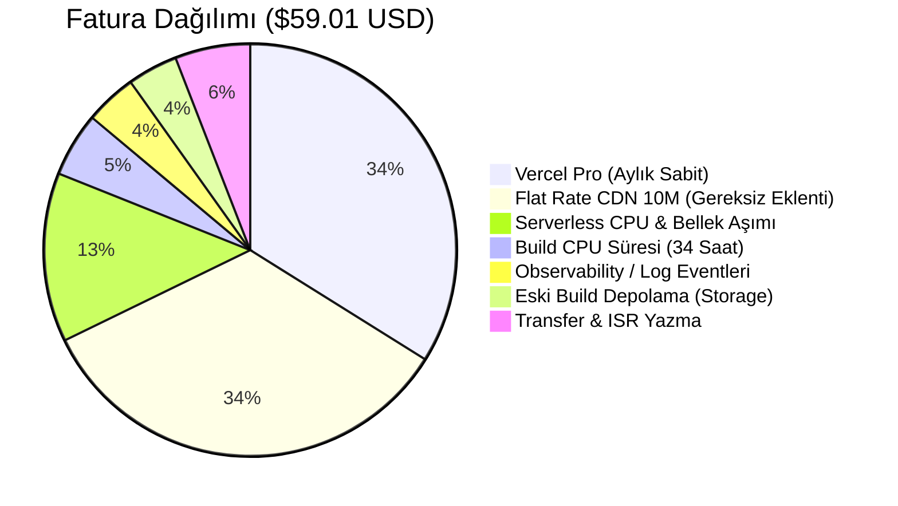

# 📊 Vercel Fatura Analizi & Optimizasyon Eylem Planı

> **Rapor Tarihi:** 4 Kasım 2026  
> **İncelenen Fatura:** `Invoice-XWZVG5ZN-0022.pdf`  
> **Ödenecek Tutar:** **$59.01 USD**  
> **Son Ödeme Girişimi:** **6 Kasım 2026** (Kritik Tarih)

---

## 1. Fatura Özeti ve Masraf Dağılımı

Faturadaki **$59.01 USD** tutar iki ana kısımdan oluşmaktadır: **$40.00** önümüzdeki ayın peşin abonelikleri, **$19.01** ise geçen ayki (3 Ekim – 2 Kasım) kota aşımlarıdır.



### A. Sabit Abonelikler ($40.00)
1. **Vercel Pro Planı (1 Koltuk):** `$20.00` *(Standart aylık üyelik bedeli)*
2. **Flat Rate CDN 10M:** `$20.00` *(🚨 Gereksiz 50 TB trafik paketi. Pro planda zaten 1 TB kota dahil olduğu için bu eklentiye hiç gerek yoktu).*

### B. Kullanım Aşımları ($19.01)
- **Fluid Active CPU & Provisioned Memory:** `$7.83` *(Ayda 3.4 milyon fonksiyon çağrısı)*
- **Build CPU Minutes (2.044 dakika ≈ 34 saat build):** `$2.98`
- **Observability Events (3.416.790 log kaydı):** `$2.39`
- **Serverless Function & Deployment Storage:** `$2.33` *(Silinmeyen eski preview build'ler)*
- **Fast Origin Transfer & ISR Writes:** `$3.48`

---

## 2. Korumamız Gereken Kırmızı Çizgiler (Değişmeyecekler)

> [!IMPORTANT]
> Kullanıcı talebi doğrultusunda aşağıdaki metrikler **kesinlikle kısıtlanmayacak veya düşürülmeyecektir**:
> 1. **Vitrin Gösterim Sayıları (Impressions):** Kullanıcılara/modellere sunulan raporların yüksek ve zengin çıkması için vitrinde yüklenen her kartın gösterim sayılması mantığı **aynen korunacaktır**. (Uluslararası kısıtlayıcı süre kuralları uygulanmayacaktır).
> 2. **Online Canlı Sayaç:** Sitede o an kaç gerçek kullanıcı olduğu anlık ve eksiksiz çalışmaya devam edecektir.
> 3. **Tüm Zamanlar / Günlük İstatistikler:** Ziyaretçi sayıları, tekil kullanıcılar, şehir ve kaynak analizleri hiçbir veri kaybı olmadan tutulacaktır.

---

## 3. Bugüne Kadar Panelde Yapılanlar (Tamamlandı ✅)

1. **Deployment Retention Policy (7 Güne İndirildi):**
   - *Ayar:* `Settings -> General -> Deployment Retention`
   - *Kazanım:* 35 GB'a ulaşan eski test ve preview deployment'ların otomatik silinmesi sağlandı. Depolama kotası sıfırlandı.
2. **Observability Plus Kapatıldı:**
   - *Ayar:* `Billing -> Add-Ons -> Observability Plus -> OFF (Confirm)`
   - *Kazanım:* Her ay 3.5 milyon log için kesilen ekstra **$2.39** masraf durduruldu.
3. **Flat Rate CDN 10M Kapatıldı:**
   - *Ayar:* `Billing -> Add-Ons / Network -> Flat Rate CDN -> OFF (Save)`
   - *Kazanım:* **Her ay peşin kesilen $20.00 masraf doğrudan silindi.**

---

## 4. Akşam Evde Yapılacak Eylem Planı (Adım Adım)

### Adım 1: Acil Ödeme Kontrolü (6 Kasım Öncesi)
- [ ] Vercel Dashboard'da `Settings -> Billing` ekranına git.
- [ ] Kartının internet/yurt dışı alışveriş limitini kontrol et (veya yeni bir kart ekle).
- [ ] Bekleyen **$59.01 USD** faturayı öde. *(Ödenmezse 6 Kasım'da siteler askıya alınabilir).*

---

### Adım 2: Vercel Panelinde Son Ayar (Build Süresini Bitirme)
- [ ] Projeye gir (`bestescort` ve `turkiyeeskort`) -> `Settings` -> sol menüden `Git`.
- [ ] **"Ignored Build Step"** bölümünü bul ve **"Custom"** seçeneğine şu kodu yapıştır:
  ```bash
  if [ "$VERCEL_GIT_COMMIT_REF" != "main" ]; then exit 0; else exit 1; fi
  ```
- [ ] **Save** de.  
  *(Bu sayede test branch'leri veya preview commit'leri boş yere 3-4 dakika build alıp 34 saatlik CPU faturası çıkarmaz).*

---

### Adım 3: Kod Tarafında Yapacağımız Optimizasyonlar

Aşağıdaki düzenlemeler kod tarafında yapılarak 5.7 milyon fonksiyon çağrısı ve MongoDB kota sorunu çözülecektir:

#### A. Raporlama Sayılarını Bozmadan "Toplu Paketleme (Batching)"
- **Mevcut Durum:** Kullanıcı anasayfada gezerken her 3 saniyede bir arkada Vercel'e istek atılıyor (1 sayfada 5-10 fonksiyon uyanıyor).
- **Yeni Çözüm:** Vitrindeki tüm kartlar yine eskisi gibi sayılmaya devam eder. Ancak bu veriler parça parça değil; kullanıcı sayfadan çıkarken (`navigator.sendBeacon`) veya 50'lik büyük paketler halinde **tek bir Vercel fonksiyonuyla** gönderilir.
- **Sonuç:** İlanların `goruntulenmeSayisi` ve rapor rakamları **%100 AYNI kalır**, ama Vercel fonksiyon maliyeti **10 kat düşer**.

#### B. Arama Motoru Botlarını Filtreleme
- Sitede zaten hazır olan `isSearchEngineBot()` fonksiyonu `AnalyticsTracker.tsx`'e bağlanacak.
- Googlebot, Yandexbot gibi arama motoru botları gezindiğinde arkadan analytics ve heartbeat çalıştırmayacak.
- Gerçek insanların tüm tıklama ve gösterimleri ise **eksiksiz işlenecek**.

#### C. Gösterimle İlgisi Olmayan Arka Plan İsteklerini Önbelleğe Alma
- **Okunmamış Bildirimler (`MobileShell.tsx`):** Kullanıcı her tıkladığı sayfada Vercel'e bildirim sormayacak, `sessionStorage` ile oturumda 5 dakikada 1 kez soracak. (100.000'lerce gereksiz fonksiyon çağrısını siler).
- **Duyuru Çubuğu (`GlobalAnnouncementBar.tsx`):** Kampanya verisi oturum hafızasında tutulacak.

#### D. MongoDB Atlas 440 MB Kotasını Koruma (TTL İndeksi)
- İlanların ana tablodaki toplam görüntülenme sayısı (`Listing.goruntulenmeSayisi`) **ömür boyu kalıcı artmaya devam edecek**.
- MongoDB'yi dolduran tekil `AnalyticsEvent` kayıtlarına 15 veya 30 günlük **otomatik silinme (TTL indeksi)** tanımlanacak. Böylece veritabanı hiçbir zaman 512 MB sınırına dayanmayacak.

---

## 5. Optimizasyon Sonrası Tahmini Maliyet Tablosu

| Masraf Kalemi | Eski Fatura (Şu Anki) | Optimizasyon Sonrası |
| :--- | :---: | :---: |
| **Vercel Pro Planı** | $20.00 | **$20.00** |
| **Flat Rate CDN 10M** | $20.00 | **$0.00 (İptal Edildi)** |
| **Serverless CPU & Bellek** | $7.83 | **<$1.00 (Toplu Gönderim)** |
| **Build CPU Süresi** | $2.98 | **<$0.50 (Sadece Main Build)** |
| **Observability Events** | $2.39 | **$0.00 (Kapatıldı)** |
| **Depolama (Storage)** | $2.33 | **$0.00 (7 Gün Temizliği)** |
| **Transfer & ISR** | $3.48 | **<$1.00** |
| **TOPLAM AYLIK FATURA** | **$59.01 USD** | **~$20.00 - $22.00 USD** |

> **Net Kazanç:** Yılda yaklaşık **$450 USD tasarruf** ve sıfır veri/rapor kaybı.

